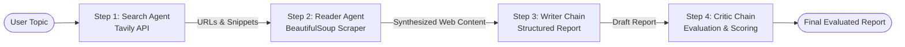

# 🤖 Autonomous Multi-Agent Research System

An intelligent, multi-agent AI research pipeline built with **LangChain**, **Google Gemini**, **Tavily Web Search**, and **BeautifulSoup**.

This system coordinates specialized AI agents and chains to autonomously search the web, scrape in-depth content from reliable sources, draft a structured research report, and review it with strict critical evaluation.

---

## 🏗️ Architecture & Workflow

The system follows a sequential 4-stage pipeline simulating a professional research and editorial team:



1. **Step 1: Search Agent**: Executes live web searches using Tavily API to gather relevant titles, snippets, and verified URLs.
2. **Step 2: Reader Agent**: Evaluates the search results, selects the top 2–3 most authoritative URLs, scrapes their page content with BeautifulSoup, and synthesizes key takeaways.
3. **Step 3: Writer Chain**: Combines search snippets and scraped insights into a well-structured research report (Introduction, Key Findings, Conclusion, Sources).
4. **Step 4: Critic Chain**: Evaluates the report strictly on factual depth, structure, and sources, assigning a score out of 10 and offering constructive feedback.

---

## 📁 Project Structure

```text
multi-agent-system/
│
├── .env                  # API keys and environment configurations
├── requirements.txt      # Project dependencies
├── app.py                # Main project entrypoint / research runner
│
├── agents/               # Multi-agent definitions & pipeline orchestration
│   ├── __init__.py       # Package initializer
│   ├── agent.py          # LLM configuration, agent builders, writer & critic chains
│   └── pipeline.py       # Standalone pipeline module
│
└── tool/                 # Custom tools for agents
    ├── __init__.py       # Package initializer
    └── tool.py           # web_search (Tavily) & scrap_url (BeautifulSoup)
```

---

## 🚀 Getting Started

### 1. Prerequisites
- Python 3.10+
- A Google AI Studio API key ([Get Gemini API Key](https://aistudio.google.com/))
- A Tavily API key ([Get Tavily API Key](https://tavily.com/))

### 2. Installation

1. Clone or download this repository:
   ```bash
   git clone <repository-url>
   cd multi-agent-system
   ```

2. Create and activate a virtual environment:
   ```bash
   # Windows
   python -m venv .venv
   .venv\Scripts\activate

   # macOS / Linux
   python3 -m venv .venv
   source .venv/bin/activate
   ```

3. Install the dependencies:
   ```bash
   pip install -r requirements.txt
   ```

### 3. Environment Configuration

Create a `.env` file in the root directory:

```env
GOOGLE_API_KEY="your-google-gemini-api-key"
TAVILY_API_KEY="your-tavily-api-key"
```

*(Optional: If you use Groq models, you can also add `GROQ_API_KEY="your-groq-api-key"`)*.

---

## 💻 Running the Application

Execute the pipeline from the project root:

```bash
python app.py
```

Enter your research topic when prompted:
```text
Enter a research topic: Latest breakthroughs in Quantum Computing in 2026
```

The pipeline will stream the progress of each step in the terminal using rich formatting:
- **Step 1**: Search agent results with titles and URLs.
- **Step 2**: Web scraping details and synthesized takeaways.
- **Step 3**: Generated research report.
- **Step 4**: Critic evaluation and score.

---

## 🛠️ Tech Stack

- **Framework**: [LangChain](https://www.langchain.com/) / [LangGraph](https://github.com/langchain-ai/langgraph)
- **LLM Provider**: [Google GenAI (`ChatGoogleGenerativeAI`)](https://ai.google.dev/)
- **Search Engine**: [Tavily AI](https://tavily.com/)
- **Web Scraping**: [BeautifulSoup4](https://www.crummy.com/software/BeautifulSoup/) + [Requests](https://requests.readthedocs.io/)
- **Terminal UI**: [Rich](https://rich.readthedocs.io/)

---

## 📄 License
This project is licensed under the MIT License.

